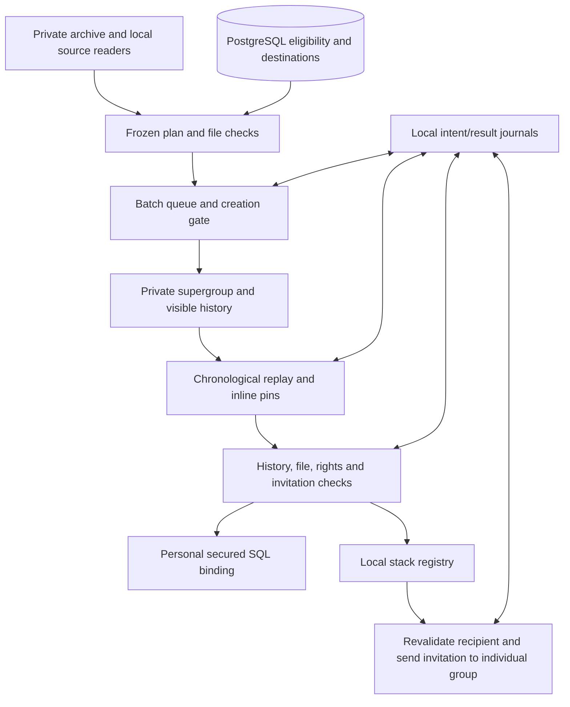

# Telegram group creation and restoration

This document describes the existing operator-run implementation. It covers personal
student groups and common stack groups under one Telegram feature. It is not a new
bot command, HTTP endpoint, scheduled worker, or permission to execute a live batch.

## Boundaries and entry points

| Component | Responsibility | Main entry points |
| --- | --- | --- |
| Personal restoration | Frozen archive plans, group creation/replay, verification, secured SQL binding | `src/features/telegram-group-restoration/batch.cjs`, `restore-additional.cjs` |
| Stack restoration | Separate stack archive/registry, service-account replay, eligible-student invitations | `src/features/telegram-stack-restoration/archive-live.cjs`, `main.cjs` |
| Shared restoration contracts | Plan construction, operation receipts, pacing, Telegram text comparison, files and invitation verification | `plan.cjs`, `runner.cjs`, `verify.cjs`, `owned-invite.cjs` in personal restoration |
| User-account transport | Existing local GramJS sessions, account identity checks, WSS, serialized RPC cooldowns | `live.cjs`, `local-wss.cjs`, `rpc-gate.cjs` |
| Bot document transport | One document supplied as a Blob through the existing `sendOne` facade | `src/integrations/telegram/types.ts`, `integration.ts`, `bot-api.ts` |
| Group administration | Separate self-join, support promotion and owner-transfer receipts | `self-join.cjs`, `support-join-one.cjs`, `support-admin-one.cjs`, `transfer-owner.cjs` |
| Mentor audit | SQL assignments compared with archived membership; report preparation is separate from delivery | `build-mentor-audit.cjs`, `check-mentor-coverage.cjs`, `refresh-mentor-documents.cjs` |



Business contracts receive adapters for saving state, sleeping, Telegram actions,
and reconciliation. Live composition owns sessions, environment loading, archives
and SQL connections. The stack adapter reuses the replay runner with its own stages;
personal-only stages, including SQL binding and bot setup, are explicit no-ops there.

## Personal group lifecycle

1. Freeze the archive scope, cutoff, ordered operations and plan hash. Preserve
   existing cohorts and journals; changed plans cannot resume an existing replay.
2. Check source identity, SQL eligibility and previous secured values. Graduated
   clients are excluded before creation except the explicitly authorized IDs in
   `graduates.cjs`; groups that already exist are preserved.
3. Create a private supergroup. Enable history for new members and read the setting
   back before replay. Restore the avatar and mute the creator's notifications.
4. Configure the bot and any required early service-account self-join. Ownership,
   sender identity and completed copies survive resume. The additional-batch sender
   contract can select an authorized replacement after a definite rejection; it does
   not switch accounts after an uncertain send.
5. Replay chronologically with original dates and author tags in the text. Telegram's
   actual send timestamps are current. Retain the batch's existing HH-report and
   attachment rules. Verify mandatory files by size and SHA-256 before upload.
6. Pin each selected source message once, using its last generated part. Include
   all pins inside the window. An older current pin precedes replay; other older
   pins are excluded. Send the configured final notice once, without pinning it.
7. Verify copies, authors, order, attachments, pins, history and invitation destination.
   Commit only `secured_general_chat_id` and `secured_general_chat_invitation_link`
   using a transaction and comparison of previous values; read the binding back.
8. Run the batch's independent member/history pilot and completion checks before
   allowing its wider queue or final invitation-file delivery.

The original personal archive is a fixed 114-group cohort. Additional restoration
has separate source-health selection and journals. Readable history alone does not
prove a working source: permissions and explicit write-test evidence matter. Missing
access or FLOOD alone does not establish that a group is broken.

## Stack lifecycle and invitation delivery

The stack runner currently supports Java, Go, DevOps and combined Python/Java AQA.
Real source chat IDs are loaded from ignored `source-scope.json`, not inferred from
the student's individual group. The archival window has a frozen upper bound and
a six-calendar-month cutoff. Source reading uses the local support connection with
a read-only request allowlist. The actual current pin is captured from Telegram.

The service account is the only creator and historical author in this batch. The
smallest group completes the pilot first; remaining groups then run concurrently.
An independent ordinary member self-joins through the verified invitation, checks
the complete history and performs the scoped send/delete test. The bot and support
account are not added to new stack groups by this runner.

After verification, the runner stores the stack invitation locally and sends it to
eligible students' individual groups. It reads SQL but never updates their secured
fields. Eligibility is exactly `studying`, `onboarding`, `on ru market`, or
`on en market`, with both AQA stack IDs included. Status, stack and destination are
re-read before every delivery. A secured destination takes priority; an original
destination is allowed only when no secured destination exists and its current
membership and send/delete probe have passed. A retired secured destination is not
replaced by an original group after a send error. Ambiguous shared destinations
are deferred.

The service account is the primary invitation sender and the observer is the
authorized fallback after a definite rejection. Unknown transport/5xx results
require reconciliation with the original account. Students join themselves; this
invitation flow does not add students directly or message their private accounts.

## Scheduling and recovery contracts

- Current shared limits are in `limits.cjs`: at most eight personal jobs, at least
  two seconds between replay sends in one group, and a 500 ms owner-send gate.
  Creation is serialized with a persisted interval of at least 60 seconds. These
  are upper bounds on concurrency, not promised Telegram throughput.
- The stack batch has four groups at most, a fully verified first pilot, its own
  account gates, and the shared creation cooldown. It shares the replay pacing.
- Explicit `FLOOD_WAIT` and Bot API `retry_after` determine the wait. Bare FLOOD
  stops the relevant account/operation; it does not authorize timed blind retries
  or stop unrelated senders automatically.
- Each external operation saves intent before acting, then saves the confirmed
  result. Stored intent without a result triggers read-back rather than resending.
  Unknown create/invite/transfer results that cannot be reconciled remain blocked.
- Process/batch/client locks prevent competing restoration work. Never remove a
  live lock, delete an uncertain intent, or change a plan hash to force continuation.
- Account self-join, support rights and ownership changes are separate operations.
  They verify exact source/target identity, preserve existing rights and use their
  own receipts. Transfers wait for the required session age and local 2FA input.

## Local prerequisites and private data

These live scripts are an operator toolkit, not a portable turnkey restoration
service. `live.cjs` currently fixes `ROOT` to
`C:/Users/kiras/TelegramArchives/VEU`. It loads private archive tools and runtime
state outside Git. Required external helpers include `history.cjs`,
`pilot-contract.cjs`, `runtime.cjs`, `store.cjs`, `source.cjs`, `rules.cjs`,
`restoration-lock.cjs`, `creator-auth.cjs`, and the media/avatar/export helpers.
Some mentor-report adapters also load scripts from ignored audit storage. A fresh
checkout alone cannot execute these live workflows.

| Data | Location / treatment |
| --- | --- |
| Original archives, users, memberships, required media | External `TelegramArchives/VEU` tree; never commit |
| Main and additional plans, settings, locks and receipts | Ignored `storage/group-restoration-v2` and `storage/group-restoration-additional` |
| Stack source scope, plan, registry and recipient reports | Ignored `storage/stack-restoration-20261023`; media in the separate external stack archive |
| Mentor audit inputs, artifacts and invitations | Ignored `storage/mentor-audit*` |
| User-account sessions | Existing local session paths; support/additional sessions outside the project |
| Login code and 2FA | Masked Windows prompt and transient named pipe; not persisted |
| Bot/API and PostgreSQL configuration | Existing ENV; never include values in reports or Git |

Some operator entry points intentionally contain fixed historical cohort/account
IDs and must be reviewed before reuse. The paths, roles and receipts identify an
authorized past operation; they are not evidence that a group is healthy today.
Do not copy sessions or archive storage to Render. Document-upload callers supply
a Blob, never a path for the shared HTTP client to read. Files are limited to
50,000,000 bytes and captions to 1024 UTF-16 units. JSON bot endpoints cannot
upload a Blob; no new endpoint or public facade method is added.

## Verification and operation

Mock-only checks, without opening sessions or running a batch:

```powershell
node --test src/features/telegram-group-restoration/*.test.cjs src/features/telegram-stack-restoration/*.test.cjs src/integrations/telegram/document.test.ts
node src/integrations/telegram/integration.test.ts
node src/features/web-console/backend/telegram-integration-routes.test.ts
npm run typecheck
```

The mock contracts cover pacing, ordering, pins, files, identity, SQL conflicts,
membership/rights/ownership reconciliation, audience eligibility and duplicate
delivery prevention. They do not prove current Telegram rights, history visibility,
external archive completeness, or unrestricted accounts. The live-isolation test
uses mocks but reads a previous local ledger when present, checking it is untouched.

For live operation consult each module's README and the corresponding private
manifest first. `batch.cjs` without `--run` prepares local plans/reports and performs
SQL reads; `--run` enables its live restoration and final delivery path. Stack
`archive-live.cjs` reads Telegram and writes local archives; stack `main.cjs` performs
live creation/replay and then invitation delivery. Several repair/admin entry points
act immediately when invoked. Publishing this code does not launch any of them.

See [personal operations](../src/features/telegram-group-restoration/README.md),
[stack operations](../src/features/telegram-stack-restoration/README.md), and
[shared Telegram transport](telegram-integration.md). CV transitions and the legacy
local My group info implementation are separate changes, not part of this release.
