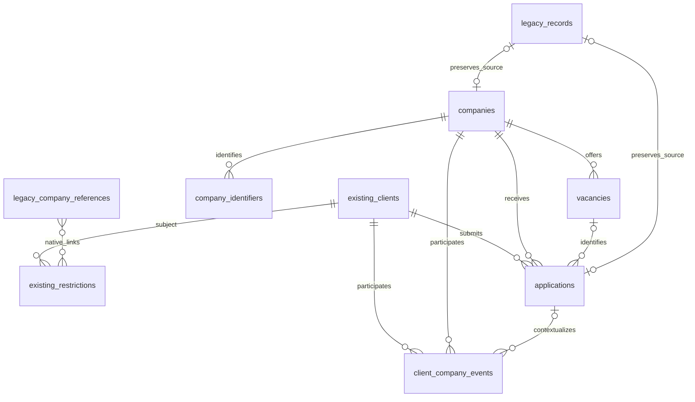

# Company/client SQL model

SQL foundation for the shared company/student model. The current model uses company identities, application history and the original student restriction sources. Historical migrations briefly introduced duplicate restriction storage; migration 005 removes it. The directory migration adds the authoritative reviewed source data, a separate `sources` table and import receipts. The existing student table is referenced by its actual PostgreSQL primary key, resolved from `copy_meta.inventory` using the existing `clients` table ID. Both metadata and the physical key must agree and use a single `bigint` key.

The canonical runtime and archive cutover are documented in [runtime-migration/README.md](runtime-migration/README.md). HH and external responses read the original restrictions table and student stop-list fields; contextual policies are external-only. Directory imports accept explicit reviewed ID mappings. Company-name identification and notification delivery remain out of scope. SQL reads and transactions reuse the repository's PostgreSQL infrastructure; migrations run only through explicit commands.

## Authoritative company directory

Start with [directory/README.md](directory/README.md) for source consolidation. After migration `003_noco_business`, `noco.companies` is the single physical employer identity table. `noco.company_directory` is its active-source view, not another table. `directory_status = legacy_reference` keeps old identities that are still required by restrictions or application history out of collection inputs. Reviewed source values override outdated migration attributes on explicitly mapped IDs.

The September 26 consolidation input contains 428 approved companies and 750 sources. Eleven existing IDs have explicit mappings; 83 unmatched identities remain only for existing links. The 94-row migration table is not a second source directory. `notify_only` is just stored data for an end-of-report section and prevents treating a record as an automatic-application target. It requires no assignee. No notification delivery or application-routing logic is implemented by this SQL work.

## Tables and relationships

Business entity IDs use PostgreSQL `bigint` identities. Workflow run/batch IDs use text; association tables retain their composite keys. New IDs do not replace old company IDs; `legacy_record_id` retains an explicit link to the original table and record key.

| Table | Important columns and links |
| --- | --- |
| `companies` | `name`, `website`, `parent_company_id → companies`, `merged_into_id → companies`, `legacy_record_id → legacy_records`, `source`, timestamps. Names are not unique. |
| `company_identifiers` | `company_id → companies`, `type` (`alias`, `domain`, `external_id`), `namespace`, `value`, `verification_status`, `source`, timestamps. Only verified external IDs are unique across companies within a namespace. Aliases/domains can be shared. Storage only; no matching algorithm. |
| `client_company_restrictions_from_stop_companies` (existing) | Existing student FK, market, native blocked-company links and contextual text. Also reuse `clients.stop_list_company`. No replacement restriction table. |
| `vacancies` | `company_id → companies`, `title`, `canonical_url`, `apply_url`, `platform`, `external_namespace/id`, `description`, `location`, `availability`, `last_checked_at`, `sources`, timestamps. Source JSON can retain workbook cells and Telegram provenance. |
| `applications` | `client_id → existing clients`, `company_id → companies`, `vacancy_id → vacancies`, `channel`, `submission_status`, `recruitment_stage`, `reason_code`, `confirmation_kind`, `confirmed_at`, `evidence`, `legacy_record_id`, `source`, timestamps. |
| `client_company_events` | `client_id → existing clients`, `company_id → companies`, optional `application_id → applications`, `event_type`, nullable `occurred_at`, `recorded_at`, `assertion_status`, `source`, `evidence`, `legacy_record_id`, optional `supersedes_event_id → events`. Append-only. |
| `legacy_records` | Unique original `source_table_id/source_key`, `kind`, immutable `payload` and `payload_sha256`, `review_status`, `issues`, `recorded_at`. Includes unresolved sources, not just successfully linked records. |
| `schema_migrations` | Applied `version`, rendered SQL `checksum`, `applied_at`. |
| `sources` | `company_id → companies` nullable for general aggregators/channels, `type`, URL, disposition, comment, provenance, unique import key. |
| `noco.collection_runs` | Collection and classification checkpoints, keyed by run ID. |
| `noco.vacancy_stacks` | Run/vacancy/stack links with matching evidence and native foreign keys. |
| `noco.application_batches` | Student/batch keys, frozen targets and resumable application state. |
| `directory_imports` | Immutable source snapshot, pre-import SQL records, checksum, counts and completion timestamp. |



Foreign keys use `ON DELETE RESTRICT`; there are no cascading data deletions. Composite foreign keys prevent an application referencing another company's vacancy and an event referencing another student's application or correction event. A unique student/vacancy pair applies across all channels and statuses, including `unknown`. Company-only legacy applications may have `vacancy_id = NULL`; a new exact vacancy is never invented during import.

Student restrictions are read from their original table, native links and student stop-list field. Contextual interpretation is external-only; HH enforces company/name bans. Global vacancy-selection rules are configured in `.agents/skills/vacancy-selection/SKILL.md`. See [restriction contracts and cleanup](restrictions/README.md).

`submission_status` values: `queued`, `preparing`, `needs_action`, `submitting`, `submitted`, `failed`, `unknown`, `skipped`.

`recruitment_stage` values: `unknown`, `not_started`, `screening`, `interviewing`, `offer`, `hired`, `rejected`, `withdrawn`, `closed`.

`submitted` requires a nonempty evidence object, confirmation time, and `captured` or `candidate_reported` confirmation kind. These SQL constraints validate structure; the application adapter must still verify that the evidence actually proves receipt. Interviewing or an offer is not automatically proof of submission. Corrections to events are new rows referencing the previous event, never edits of old events.

## Views

`company_directory` selects active collection companies. The redundant `active_restrictions` and `client_company_summary` views are removed by migration 005. Application outcomes remain in `applications`; resumable execution remains in `application_batches`.

## Historical migration commands

Current business objects belong to schema `noco` and the existing **PostgreSQL** NocoDB source. See [relocation/README.md](relocation/README.md) for the explicit `relocate-plan` / `relocate-apply` deployment. It moves the original objects after migrations 001/002 without copying rows or changing IDs. Only receipts, import evidence/backups and trigger helpers remain in the internal `company_management` schema. Do not create a separate NocoDB data source. The historical migration files below are immutable; historical installations apply 001–004 followed by [005](restrictions/README.md) and [006](workflow-relocation/README.md). Do not use the old policy model as the final schema. Import commands inspect the applied receipt and address the correct business schema.

```powershell
npm run company:sql -- plan --env C:\private\unicorn-sql.env --out .tmp\company-model\001_core.sql
npm run company:sql -- apply --env C:\private\unicorn-sql.env --expect-checksum <checksum-from-plan>
```

`plan` only reads database identity, current catalog/primary-key metadata, and any migration receipt. With `--out`, it writes rendered SQL plus a `.json` plan sidecar. Output files are never overwritten. The SQL template contains student-table placeholders; use the runner, which resolves and quotes them, checks the database marker, takes a transaction-level advisory lock, and commits DDL together with its receipt. Do not execute the template as raw SQL.

Only the existing marked `unicorn_noco_copy` or `unicorn_noco_copy_restore` connections are allowed, using the repository's TLS/local-tunnel configuration. An explicit reviewed checksum is mandatory for `apply`. Missing or incompatible metadata, an unmanaged existing schema, a changed migration checksum, or an incomplete applied schema stops the operation. Identical subsequent invocations do not run DDL again. A lost COMMIT acknowledgment is `commit_uncertain`; inspect with `plan` before deciding what to do next. No automatic retry.

The plan names the selected database and reports `deployment.allowed` and `deployment.missingPrivileges`. Rendering still works with a restricted application account. Creating the schema requires database `CREATE`, `USAGE` on the existing student schema, and `REFERENCES` on its primary-key column; a column-level grant is sufficient. `apply` rechecks these permissions and stops with `company_schema_permission_denied` before DDL when any are absent. Reconciling an already applied migration does not require `CREATE` again.

Use an approved migration account for deployment. This command does not grant privileges, change the connected Noco configuration, register these tables in the old `copy_meta.inventory`, or switch the current AppDb adapters. Noco schema visibility and runtime adoption are separate deployment steps. No existing table is renamed, dropped, or made read-only by this migration. If the migration account differs from the application account, access to the new schema, tables and identity sequences must be provisioned separately before import/runtime adoption.

## Historical legacy import without name identification

This one-time import is closed after migration 005; edit original restrictions directly. The following describes the historical import only.

```powershell
npm run company:sql -- export-legacy --env C:\private\unicorn-sql.env --out .tmp\company-model\legacy.json
npm run company:sql -- import-legacy --input .tmp\company-model\legacy.json --dry-run
npm run company:sql -- import-legacy --env C:\private\unicorn-sql.env --input .tmp\company-model\legacy.json --apply --expect-checksum <snapshot-checksum> --out .tmp\company-model\import-report.json
```

Export uses one `REPEATABLE READ READ ONLY` transaction, current SQL columns and native relation tables. It captures the old company directory, restrictions, application history, and nonempty student `stop_list_company` fields. Other student contact fields are not copied. Full raw source JSON is retained for the three legacy domain tables. Export failure aborts the snapshot instead of treating missing reads as empty data. The snapshot and report are private local files; console output contains counts, checksums and paths only.

Import defaults to an offline dry run: validates the input and returns a checksum/counts without opening a database connection. It does not claim that all IDs resolve until the live import checks them. `--apply` plus the snapshot checksum explicitly enables writes into the new schema. All records import in one transaction under the same advisory lock as the schema migration.

- One old company ID becomes one new company record. Equal names remain separate. No identifiers are generated or matched.
- Existing native student/company links create active `legacy_stop_list` restrictions. Their raw reason fields stay in the immutable source record. Assigning individual reasons from old multi-company text lists is marked for review because it would require name identification. `both`/empty market maps to `all`; unknown market values retain a conservative all-market block and an issue.
- Missing/ambiguous students never produce global rules. Unresolved company links and free-text stop lists are retained with review issues. Resolved restriction links are still imported when another company link is unresolved.
- Usable application links produce company-level legacy applications with `submission_status = unknown`, no confirmation, and no guessed vacancy. Original `status_raw` is recorded as a `legacy_unverified` company event with unknown occurrence time.
- A repeated identical snapshot skips existing records and preserves operator edits/revocations. Changed source content for an already imported key stops with `legacy_source_changed`, requiring explicit reconciliation. This is a point-in-time migration, not background synchronization.

Historically, migration 004 supplied the copied-policy runtime cutover; older migration commands do not perform it. This differs from source-directory authority: reviewed directory rows are authoritative for company collection, and historical migration identities must not expand that collection scope. The runtime migration preserves unresolved text as contextual policies, imports the existing global HH list, verifies unchanged legacy snapshots and compares old/new HH block coverage before allowing archival.

## Validation

```powershell
npm run company:sql:test
npm run typecheck
```

Tests execute the migration and constraints in the development-only PGlite PostgreSQL engine. They cover SQL rollback, database identity rejection, quoted primary-key mapping, idempotency, review-preserving restrictions, global-rule validation, cross-channel application uniqueness, consistent student/company links, append-only evidence, conservative legacy imports and lost COMMIT acknowledgment. Snapshot/CLI contracts cover pagination, missing native relations and explicit mutation modes.

PGlite is an isolated single-connection engine. Tests validate PostgreSQL SQL/constraints and advisory-lock use, but do not claim a multi-host concurrency or real server permission test. A deployment preflight against the actual database remains required.
